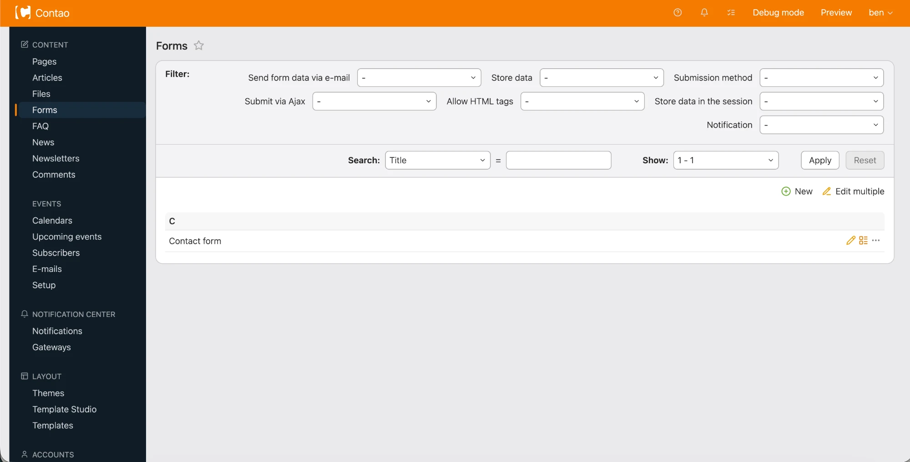
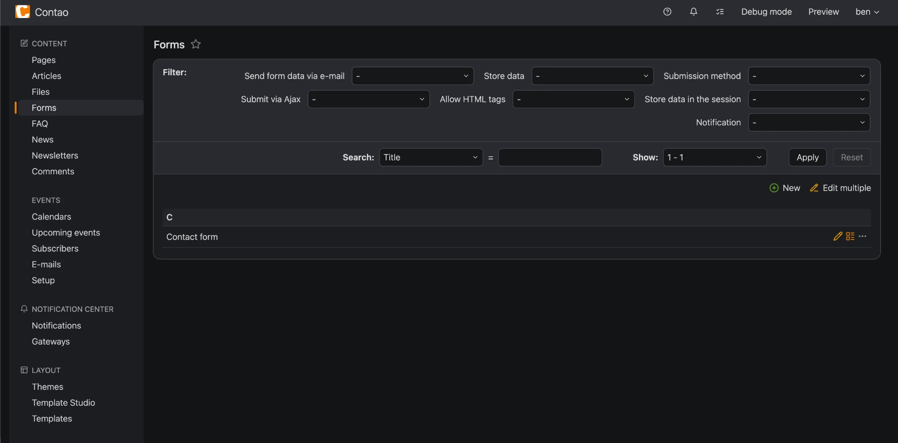

# Classic back end for Contao

Contao 5.7 gave the back end a light, white look and moved the list filters into a column on the right.
This extension adds two options to each user's profile that bring back the look many editors know from
Contao 4 and 5.6. Each user chooses for themselves, and anyone who doesn't keeps the standard 5.7 back end.

Both options are styling only: no core templates are overridden and no Contao behaviour changes.





## Classic theme

The Contao 5.6 colours on top of the 5.7 back end:

- orange header with white text and icons
- dark navy navigation with the old highlight on the current page
- the greyer page background, borders, table rows, form fields and buttons
- dark mode with the 5.6 charcoal header and dark navigation

Text colours keep their 5.7 values, which were changed to meet WCAG contrast. The logo and icons are the
ones that ship with Contao 5.7; the extension contains no images of its own.

**Switch it on:** user menu › *Profile* › section *Back end theme* › *Back end theme*: **Classic**.

## Filters above the list

The 5.7 search and filter column becomes a bar above the list, laid out like the Contao 4 filter bar:

- a **Filter:** row with each filter's name and dropdown, right-aligned and wrapping as needed
- **Search: [field] = [keyword]**, **Sort:** and **Show:** on the row below, with *Apply* and *Reset*
- joined to the top of the list as one box, so the list gets the full width

It applies on screens 1280px and wider. Below that, 5.7 already hides the filters behind its *Filter*
button, and that stays as it is. It works with or without the Classic theme.

**Switch it on:** user menu › *Profile* › section *Back end theme* › tick **Filters above the list**.

Administrators can set both options for other users under *Accounts* › *Users*.

## Installation

In the Contao Manager, search for `360fusion/contao-backend-classic`, or with Composer:

```bash
composer require 360fusion/contao-backend-classic
vendor/bin/contao-console contao:migrate
```

The database update adds one column, `tl_user.filtersOnTop`.

## Requirements

- Contao 5.7 (tested with 5.7.15) and PHP 8.3
- Back end languages: English and German
- A current browser: Chrome or Edge 120+, Safari 17.2+, Firefox 121+. The stylesheets use `:has()` and
  CSS nesting; older browsers show the standard 5.7 back end in places.
- Contao installed at the root of its domain, as the stylesheets link to Contao's own icons by path

## How it works

An event listener adds a stylesheet to back end pages for users who picked an option. *Classic* is listed
in the *Back end theme* dropdown but has no theme folder, so Contao keeps the standard `flexible` theme
as the base and the Classic colours are layered on top.

## Updating Contao

The stylesheets are written against the Contao 5.7 back end markup and colour variables. A future Contao
release that changes these may need an update of this extension; check it before upgrading beyond 5.7.

## Uninstalling

Remove the package with the Contao Manager or `composer remove 360fusion/contao-backend-classic`. Users
who picked Classic fall back to the standard theme automatically. The `tl_user.filtersOnTop` column stays
until the next database update removes it.

## Licence

MIT. Not affiliated with or endorsed by the Contao Association.
